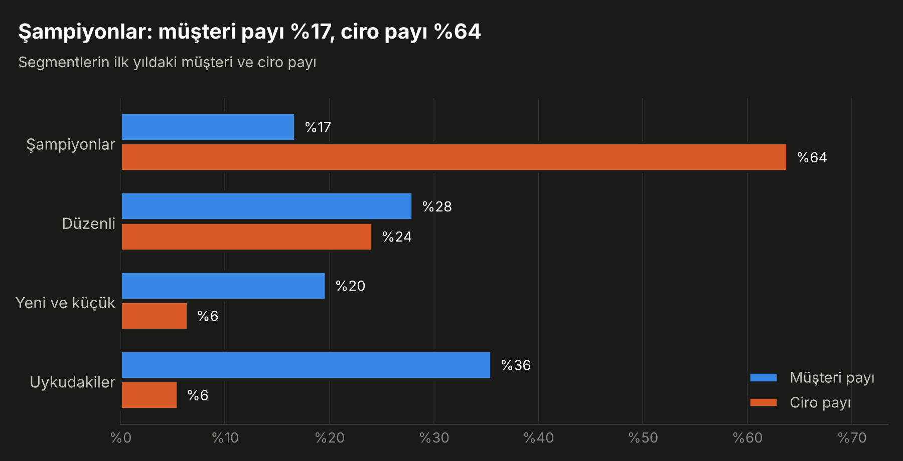
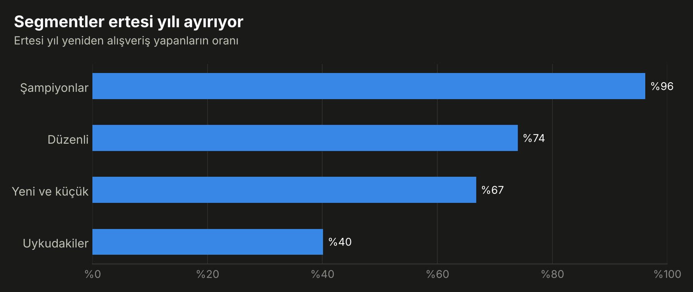

# Müşteri Segmentasyonu: RFM ve K-means, Ertesi Yılla Doğrulama

Bir online perakendecinin iki yıllık satış verisinden (UCI Online Retail II, 1.067.371 satır)
dört müşteri segmenti çıkarır ve segmentleri modelin görmediği ikinci yılla sınar.

**Rapor:** https://ozgurnurettinozturk.com/musteri-segmentasyonu

## Sonuçlar

Segmentler ilk yılın verisiyle kuruldu (01.12.2009 – 30.11.2010, 4.229 müşteri);
son üç sütun ikinci yıla aittir (01.12.2010 – 09.12.2011).

| Segment | Müşteri payı | Ciro payı | Ertesi yıl geri gelen | Müşteri başına ortalama ciro | İkinci yıl cirosundaki pay |
|---|---|---|---|---|---|
| Şampiyonlar | %16,8 | %63,9 | %96,2 | £6.348 | %66,5 |
| Düzenli | %28,0 | %24,2 | %74,0 | £1.157 | %20,2 |
| Yeni ve küçük | %19,7 | %6,5 | %66,7 | £629 | %7,7 |
| Uykudakiler | %35,5 | %5,5 | %40,1 | £247 | %5,5 |

- Müşterilerin %17'si cironun %64'ünü getiriyor.
- Segmentler ertesi yılki davranışı ayırıyor: geri gelme oranı %96 ile %40 arasında değişiyor.
- "Uykuda" görünen müşterilerin %40'ı bir yıl içinde geri geldi.




## Çalıştırma

1. [Online Retail II](https://archive.ics.uci.edu/dataset/502/online+retail+ii) dosyasını indirip
   `data/online_retail_II.xlsx` olarak kaydet.
2. Çalıştır:

```bash
pip install -r requirements.txt
python 01_prepare.py     # Excel -> data/online_retail_II.csv
python 02_segment.py     # temizlik, RFM, K-means, doğrulama, grafikler
```

Çıktılar: `outputs/summary.json`, iki grafik ve `data/rfm_segments.csv` (müşteri bazında segment).

## Yöntem

1. **Temizlik:** Birebir tekrarlar, müşteri numarası olmayan satırlar, ürün olmayan satırlar
   (kargo, düzeltme, masraf) ve sıfır fiyatlı satırlar atılır. 1.067.371 satırdan 794.163'ü kalır.
   İadeler atılmaz; müşterinin cirosundan düşülür.
2. **RFM:** Son alışverişten bu yana gün, fatura sayısı, iadeler düşülmüş net ciro.
   Üçü de sağa çarpık olduğu için logaritma alınıp standartlaştırılır.
3. **Küme sayısı:** K = 2…7 için siluet skoru ve kararlılık (yeniden örneklemeyle ARI).
   En yüksek siluet K=2'de (0,41), ama yalnızca aktif/pasif ayrımı yapar. K=4 ikinci en iyi siluete
   (0,34) ve yüksek kararlılığa (0,93) sahip olduğu için seçildi.
4. **Doğrulama:** Segmentler yalnızca ilk yılın verisinden kurulur; ikinci yıl hiç kullanılmaz.

## Sınırlar

- Tek şirket; müşterilerin birçoğu toptancı.
- Satırların %22,8'inde müşteri numarası yok (cironun %13,7'si); bunlar analiz dışında.
- Siluet 0,34: kümeler keskin sınırlarla ayrılmıyor.
- Doğrulama dönemi 374 gün.
- Segment isimleri profillere bakılarak konmuş yorumlardır.

Veri: Chen, D. (2019). Online Retail II. UCI Machine Learning Repository.
